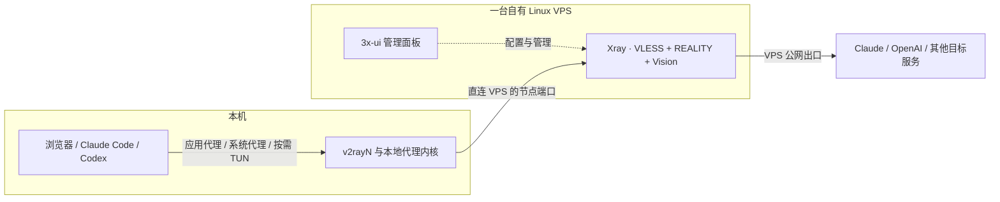

# vpn-deploy · 单台 VPS 直连搭建技能

把个人代理节点的搭建、排障和多设备管理整理成可供 AI 助手使用的 Skill，也可以当作人工操作指南阅读。

**本仓库记录的方案是：本机用 v2rayN 直连一台自有 VPS，由这台 VPS 提供最终公网出口。** 服务端使用 3x-ui 管理 Xray，选用 VLESS + REALITY + Vision。主要使用场景是本机访问 Claude、Codex 及其他需要代理的应用。

这里沿用日常说法“VPN 搭建”；技术上是代理节点方案。哪些流量经过它，取决于系统代理、应用自身代理设置或 TUN 与路由规则，并不等同于安装后所有程序自动走代理。

## 我的方案是怎样工作的



“直连”指本机直接连接这台 VPS，中间没有另配机场节点或自建中转 VPS。它不代表目标应用绕过代理直接访问网站，也不表示互联网底层没有运营商路由器。

| 组件 | 在这套方案中做什么 | 在哪里运行 |
| --- | --- | --- |
| v2rayN | 管理节点、选择本地代理模式与路由，调用客户端内核 | Windows 本机 |
| VPS | 接收代理连接，并向目标服务建立连接；承担入口与最终出口两个角色 | 一台租用的服务器 |
| Xray | 执行代理协议、认证和流量转发 | VPS；本机客户端也需要相应内核 |
| 3x-ui | 管理 Xray 入站、用户、用量和订阅 | 与 Xray 同一台 VPS |
| VLESS + REALITY + Vision | 本路线选用的认证、传输保护与流控组合 | 客户端与服务端配置相互匹配 |
| Claude / Codex | 实际使用的应用与远端服务 | 本地客户端访问相应服务 |

3x-ui 不是流量必须再经过的一台机器。VPS 在本方案中只承担代理工作，不需要在 VPS 上安装 Codex、上传开发仓库或运行本地构建任务。云端执行的任务、连接器或其他远端环境有自己的出口，不会因为本机启用 v2rayN 就自动经过这台 VPS。

## 为什么默认只用一台 VPS

当本机能正常连接 VPS，且它满足带宽、流量与使用需求时，单台方案更容易配置、维护和定位故障，也只需维护一台服务器。本仓库不绑定国家、服务商、价格或所谓“零风险 IP”。

| 方案 | 远程节点的分工 | 何时可能有价值 |
| --- | --- | --- |
| 本方案：单台 VPS 直连 | 同一台 VPS 同时作为入口和最终出口 | 当前直连路径已满足需要 |
| 机场入口 + 自有 VPS 出口 | 机场帮助到达 VPS，目标服务的连接仍从 VPS 发出 | 本机到 VPS 的路径差，而机场到它的路径经实测更好 |
| 自建中转 VPS + 出口 VPS | 第一台负责中转，第二台提供最终出口 | 有明确的线路优化需要，且愿意管理两台机器 |

**多一跳本身不等于更稳定，也不等于账号更安全。** 多跳可能用另一条线路改善连通性，同时增加成本、配置和故障点。它不是 Claude 或 Codex 要求的网络结构。

## 中转、出口 IP 与 Claude 账号风险

本项目区分“连接是否可用”和“账号是否符合平台要求”。如果最终仍从同一台 VPS、同一个公网 IP 连接目标服务，增加前置中转不会自动改变这个出口 IP 的归属或历史，也不会让登录和使用行为消失。因此，不能只根据多一跳就判断封号风险下降。这是网络结构上的判断，不是平台公布的封号概率或安全保证。

“平台只看最后一跳 IP”只能用来粗略解释连接来源，不能用来概括账号风控。Anthropic 的[隐私政策](https://www.anthropic.com/legal/privacy)说明还会收集设备和使用信息；[账号警告与申诉说明](https://support.claude.com/en/articles/8241253-safeguards-warnings-and-appeals)列出使用政策、账号创建地区和服务条款等原因。上述说明没有提供按中转跳数计算风险的公式。

本仓库按技术结构比较方案，不推荐具体国家，也不把更换出口或增加中转当作满足地区、账号及使用规则的证明。“住宅 IP”“干净 IP”或第三方检测分数均不构成不封号承诺。多设备使用独立 UUID 便于统计和撤销，它们仍可共享同一个出口 IP；代理凭据也不等于 Claude/OpenAI 账号。

更详细的解释见[架构与使用边界](skills/vpn-deploy/references/architecture.md)。

## 这个技能能帮你完成什么

- 从已有进度继续：核对 VPS 与 SSH、检查系统和现有服务，按需部署 3x-ui。
- 配置本路线的入站与客户端：VLESS、REALITY、Vision、密钥、SNI、Short ID 及用户关联。
- 导入 v2rayN，分别验证本地代理、真实出口和目标应用。
- 处理常见问题：客户端为 0、订阅包含了其他人的配置、浏览器可用但 CLI 不通、证书告警等。
- 按个人或设备分配凭据，说明撤销、泄露处理和回滚方式。
- 在本地离线检查 VLESS 链接结构，不上传或回显链接中的秘密。

它是一套供助手按当前环境执行的流程，**不是点击一次就修改所有设置的自动安装器**。已有可用节点时先排查，不默认重装；仅阅读或安装技能，也不会授权助手连接服务器或修改网络。

## 安装到 Codex

可以向 Codex 的技能安装器发送：

```text
使用 $skill-installer，从 https://github.com/Aaron-shi-bot/vpn-deploy
安装 skills/vpn-deploy 目录中的技能。
```

也可以手动下载仓库，把整个 `skills/vpn-deploy` 文件夹放到 Codex 支持的技能目录。当前官方文档列出的用户目录为 `~/.agents/skills/`，项目目录为 `.agents/skills/`。不要只复制 `SKILL.md`，其引用的脚本和文档也需要保留。如果已有同名技能，先核对内容和安装位置，避免产生多个同名副本。

在 Windows PowerShell 中，从本仓库根目录执行下面的命令可安装到当前用户目录；目标已存在时会停止：

```powershell
$skillSource = Join-Path (Get-Location) 'skills/vpn-deploy'
$skillParent = Join-Path $HOME '.agents/skills'
$skillTarget = Join-Path $skillParent 'vpn-deploy'
if (-not (Test-Path -LiteralPath (Join-Path $skillSource 'SKILL.md'))) {
    throw '请先切换到本仓库根目录。'
}
if (Test-Path -LiteralPath $skillTarget) {
    throw '目标技能已存在，请先核对已有版本。'
}
New-Item -ItemType Directory -Path $skillParent -Force | Out-Null
Copy-Item -LiteralPath $skillSource -Destination $skillTarget -Recurse
```

技能未显示时重新启动 Codex。安装位置和调用方式以 [Codex 官方技能文档](https://learn.chatgpt.com/docs/build-skills)为准。其他支持 `SKILL.md` 的助手可参考同一目录，但需按各自发现机制安装；本项目未逐一验证所有宿主。

## 怎样使用

```text
使用 $vpn-deploy，按单台 VPS 直连方案指导搭建。
我已经有 VPS，请先检查已有服务，从当前进度继续，不要默认重装。
```

```text
使用 $vpn-deploy，排查 v2rayN 能上网但 Claude Code 无法连接的问题。
先区分本地代理、出口、应用代理设置与账号错误，再做必要修改。
```

```text
使用 $vpn-deploy，为自己的几台设备设计凭据分配方式，
需要能单独撤销丢失设备，并检查每份订阅只含其授权配置。
```

开始实际部署前，需要明确服务器、已知 SSH 端口、系统、现有服务、客户端版本及允许的改动。密码与私钥使用安全输入方式，不贴到公开 Issue 或提交到仓库。

## 按阶段阅读

| 入口 | 内容 |
| --- | --- |
| [SKILL.md](skills/vpn-deploy/SKILL.md) | AI 助手的执行入口与关键约束 |
| [架构与使用边界](skills/vpn-deploy/references/architecture.md) | 单台直连、增加中转的条件、Claude/Codex 代理覆盖与账号风险 |
| [部署流程](skills/vpn-deploy/references/deployment.md) | 准备、系统检查、面板、入站、客户端、验收和回滚 |
| [排障与多设备分发](skills/vpn-deploy/references/troubleshooting.md) | 按失败层排查、专属订阅、撤销与泄露处理 |
| [来源与修正](skills/vpn-deploy/references/sources.md) | 官方来源、版本变化及原流程中不应照搬的结论 |
| [离线检查脚本](skills/vpn-deploy/scripts/check_vless.py) | 仅用 Python 标准库的链接检查器 |

## 离线检查与验证范围

从仓库根目录运行，文件路径换成保存在仓库外的私密文件：

```text
python skills/vpn-deploy/scripts/check_vless.py --input <本地私密文件路径> --expect-count 1
```

需要 Python 3.10 或更高版本，无第三方运行依赖。支持普通文本或 Base64 VLESS 订阅，最多 1 MiB；不抓取订阅 URL，不支持通用 YAML/JSON 订阅。检查器针对本路线的 REALITY + Vision + TCP/RAW，并会拒绝该分发场景下的重复 UUID。输出是检查结果，不包含原始链接或认证字段。

运行现有离线回归测试：

```text
python -B -m unittest discover -s tests -v
```

发布准备时已验证 **17 项离线测试**，使用的域名和凭据均为合成数据。测试涵盖字段缺失、格式错误、数量不匹配、重复 UUID、私钥误入、超长输入及输出不泄露输入秘密等情况。GitHub Actions 会在推送和 Pull Request 时运行同一组测试。

**测试通过只说明检查器符合这些测试，不代表真实服务器部署成功。** 实际部署仍需分别验证服务运行、指定端口、REALITY 握手、预期出口及目标应用请求；各步骤没测就写“待验证”。本次发布没有连接或重新部署私人 VPS。

## 公开内容范围

本仓库仅包含通用流程、说明、脚本与合成测试数据，不包含真实 VPS 地址、账号、面板路径、UUID、订阅 Token、REALITY 私钥或个人聊天记录。原始案例中的私人分享入口不随公开版分发。提交问题时请只附已脱敏的错误信息、版本与失败步骤。

3x-ui、Xray 和 v2rayN 均通过官方来源另行获取，本仓库不打包它们的程序；各上游项目的许可和要求以其仓库为准。
